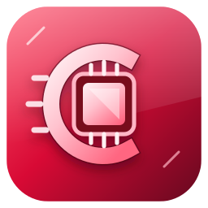

<p align="center">
  <a href="https://github.com/Frame121/CherryRed">
    
  </a>
</p>

<h1 align="center">CherryRed</h1>

<p align="center">
  <strong>Experimental AMD graphics research for macOS.</strong><br>
  Exploring native display and Metal acceleration paths for Radeon GPUs beyond Apple's supported generations.
</p>

<p align="center">
  <a href="https://github.com/Frame121/CherryRed"></a>
  <a href="LICENSE"></a>
  
</p>

<p align="center">
  <sub>Cherry Red edition ┬╖ Research first, hardware claims backed by evidence.</sub>
</p>

---

## About CherryRed

CherryRed is the renamed continuation of **Cobalt64**. The project preserves Cobalt64's existing code, research history, and third-party attributions while establishing CherryRed as the current project name. This repository investigates graphics-driver components and compatibility paths for modern AMD Radeon GPUs on macOS, including bring-up code, display-engine helpers, command-stream translation research, host-side tests, and hardware-evidence tools.

The codebase includes an experimental RDNA 4 / Navi 48 bring-up path and a separate research track for RDNA 3 / Navi 33, including the Radeon RX 7600. These tracks have different evidence and validation states; passing a host-side test does **not** mean a GPU is supported by macOS.

## Support status

| GPU family | Example GPU | Current status |
|---|---|---|
| RDNA 4 / Navi 48 | Radeon RX 9070 XT | Experimental bring-up path inherited from Cobalt64. Reported results are limited to the documented test configuration; this is not a general-purpose release. |
| RDNA 3 / Navi 33 | Radeon RX 7600 | **Research only. Not supported for working macOS graphics acceleration.** Real-card IP Discovery evidence and hardware validation are still missing. |
| Other GPUs | Varies | Not claimed as supported unless documented with reproducible evidence. |

**Important:** CherryRed is not currently a plug-and-play driver. No installer or stable public release is provided here. Do not assume that a successful build, parser test, or OpenCore boot proves that a GPU is initialized or accelerated.

## RX 7600 / Navi 33 research

The Navi 33 work is deliberately evidence-gated. The project will not enable hardware initialization based on guessed IP versions or data copied from a different GPU family.

Current research includes:

- A bounded IP Discovery parser and host-side regression tests.
- A [Navi 33 driver foundation](src/navi33-driver/README.md) with bounded
  firmware and IP Discovery inspection, software VRAM address allocation,
  preparation checked against input IP records, rollback,
  and compilation checks against real kernel headers. Hardware initialization
  and graphics acceleration remain unimplemented.
- An isolated, opt-in [macOS PCI diagnostic](src/navi33-probe/README.md)
  that reads identity and declines driver attachment; macOS CI build/signing
  passed, hardware validation is pending, and it provides no display or Metal acceleration.
- A read-only scanner for inspecting the installed Windows AMD driver file.
- Evidence, provenance, and source-verification notes under [`tools/ipdisc/`](tools/ipdisc/).
- A documented Windows-only workflow while a trusted Linux environment is unavailable.
- An explicit separation between Navi 48 routing and unverified Navi 33 support.

Still required before claiming RX 7600 support:

1. A real-card IP Discovery artifact with reproducible provenance.
2. Verified Navi 33 IP and firmware mapping from authoritative sources.
3. A macOS build and review with the appropriate SDK/toolchain.
4. Hardware validation of initialization, display output, memory handling, and Metal workloads.

See the [Navi 33 research notes](tools/ipdisc/RX7600_NAVI33_EVIDENCE.md), [evidence acquisition plan](tools/ipdisc/RX7600_EVIDENCE_ACQUISITION_PLAN.md), and [Windows-only plan](tools/ipdisc/WINDOWS_ONLY_PLAN.md).

## Repository map

| Path | Purpose |
|---|---|
| `src/navi48-bringup/` | Experimental Navi 48 IOKit bring-up code and host-side tests inherited from Cobalt64. |
| `src/dcn41/` | Display Core 4.1 helpers and register-related tooling. |
| `src/navi33-research/` | Isolated research code and tests for the Navi 33 investigation. |
| `src/navi33-probe/` | Read-only macOS PCI diagnostic source for `1002:7480`; no initialization or acceleration. |
| `src/navi33-driver/` | Freestanding firmware/resource preparation library, host tool and tests; no hardware backend. |
| `src/navi33-survey/` | Survey and research material for Navi 33. |
| `src/xlat12/` | Command-stream translation components and supporting tables. |
| `src/g2capture/` | Small shader-compiler record capture utility. |
| `tools/ipdisc/` | IP Discovery parsing, evidence intake, provenance notes, and Windows inspection tools. |
| `tools/native/` | Native helper tools and experimental Metal-related components. |
| `tools/dcn41/`, `tools/pc/`, `tools/conductor/` | Build helpers, host tools, hardware test scripts, and test harnesses. |
| `mesa-patches/` | Experimental RADV/Mesa Darwin-port patches and their notes. |
| `docs/assets/` | Project logo and visual assets. |

## Running the Navi 33 host tests on Windows

These tests exercise research code on the host. They do not load a kernel extension, initialize the GPU, or validate macOS acceleration.

From the repository root in PowerShell:

```powershell
python -B tools\ipdisc\test_ipdiscovery.py
python -B tools\ipdisc\test_scan_windows_driver.py
ctest --test-dir build\navi33-research-msvc -C Debug --output-on-failure
ctest --test-dir build\navi33-research-msvc -C Release --output-on-failure
```

The scanner is intended for static inspection of a driver file. It does not read GPU MMIO registers or VRAM. Review the research notes and source provenance before treating any output as hardware evidence.

## Build and installation notes

- The experimental macOS components require a suitable macOS environment and project-specific dependencies; see [`BUILDING.md`](BUILDING.md) and the relevant component README files.
- Do not load experimental kernel extensions on a machine containing data you cannot afford to lose.
- Back up the system and keep a known-good boot path before any hardware bring-up.
- Firmware blobs and third-party components may have separate licences and are not automatically redistributed by this repository.

## Credits and project history

CherryRed continues the **Cobalt64** project and credits the original Cobalt64 work, repository history, and contributors. It also builds on work from the Mesa/RADV project, Linux `amdgpu` contributors, RDNA4FB, mac-amdgpu, and metal2vulkan. See component notices and third-party licence files for details. Renaming this project does not transfer ownership of third-party code or supersede their licences and notices.

CherryRed is an independent project and is not affiliated with, endorsed by, or sponsored by AMD or Apple. AMD, Radeon, and RDNA are trademarks of Advanced Micro Devices, Inc. Apple, macOS, and Metal are trademarks of Apple Inc. Experimental kernel extensions can crash or damage a system; use them only if you understand the risks.

---

<p align="center">
  <strong>Built with curiosity. Validated with evidence.</strong><br>
  <sub>CherryRed ┬╖ Continuing the Cobalt64 research legacy</sub>
</p>
